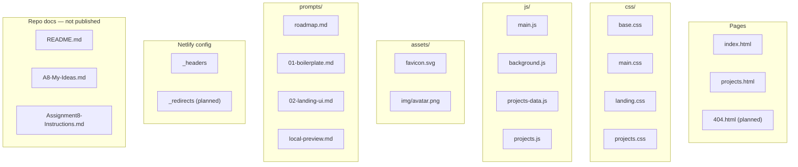
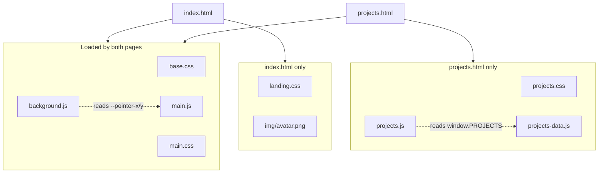

# A8 — Portfolio

Vanilla HTML/CSS/JS portfolio. Part of the Module 10: Vibe Coding of ITM 325.
<!--
## Preview

Double-click `index.html`, or serve the folder:

    python3 -m --bind 127.0.0.1

Then open <http://localhost:8000>.

## Deploy (Netlify)

1. Go to <https://app.netlify.com/drop> and drag the `Assignment8/` folder in.
   That's the fastest path and gives you a public URL immediately.
2. To auto-deploy from Git instead: connect the repo, set **Base directory**
   to `Assignment8` and leave the build command empty with publish directory `.`.
-->

## Structure

- `css/base.css` — tokens, reset, typography, buttons
- `css/main.css` — page shell
- `css/landing.css` — index.html only
- `js/main.js` — shared behaviour
- `js/background.js` — ambient canvas
- `prompts/` — the prompts used to build each step
- `_headers` — Netlify security and caching headers

## Directory layout

## What loads what

